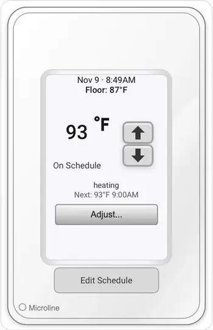
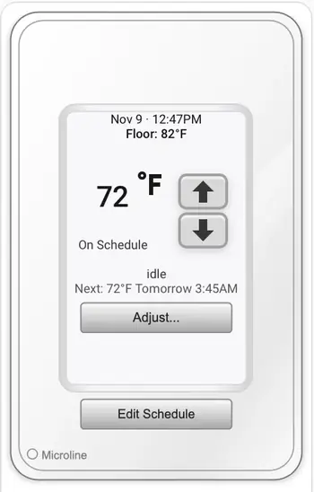

# Schluter Floor Heat Extended dashboard cards

These optional dashboard files are packaged in the **same repository** as the
`schluter_heat_extended` integration. They are deliberately separate from the
integration runtime: installing/updating the integration will not overwrite a
user's dashboard, and there are no thermostat writes during dashboard setup.

## Thermostat card previews

Both thermostat layouts are included. These are real screenshots from the
Home Assistant test installation, cropped to show the cards. Temperatures and
schedule times are examples from the time of capture.

| Full-width thermostat view | Responsive compact thermostat |
| :---: | :---: |
|  |  |
| [Full-size Picture Elements YAML](cards/bathroom-heat-extended.yaml) | [Compact Grid YAML](cards/bathroom-heat-compact.yaml) |

Use either thermostat card. The **Bathroom Floor Heat Energy** chart should
be installed as a **separate card** with
[`cards/bathroom-heat-energy-extended.yaml`](cards/bathroom-heat-energy-extended.yaml),
so its controls and chart retain enough width. The cramped combined-grid
thermostat-and-energy example has been removed.

The controls are adapted from the working `bathroom-heat-controls.js` v1.0.16
and energy viewer v1.0.4. Their package versions are **1.0.23** and **1.0.5**.
Only the integration service routing/entity checks were generalized. The
existing production files remain unchanged.

**Important:** The supplied examples use `climate.bath_heat` (the development VM's actual entity ID). Your Home Assistant installation may use another name: replace **every** `climate.bath_heat` in both card examples with your own thermostat's entity ID. The integration does not remap example cards automatically.

## Requirements

- Home Assistant 2026.11+ (tested on Home Assistant; older installations may
  also work but have not been verified)
- The `schluter_heat_extended` integration installed and a working climate
  entity, e.g. `climate.bath_heat` in the supplied example
- **Browser Mod** for the Adjust and Weekly Schedule popups. If Browser Mod is
  not installed/registered in the browser, do not expect those dialogs to open.
- Fahrenheit-based thermostat control screens; the existing controls present
  and validate target temperatures in °F.
- The controls currently display schedule times in `America/New_York`.
  Use the supplied example only for a thermostat configured in that zone.

## Install on Home Assistant (manual UI dashboard)

1. Leave the working integration and its statistics alone. Do **not** change
   `.storage`, YAML credentials, or recorder files.
2. Copy the two JavaScript files from `dashboard/www/` to your Home Assistant installation's
   `/config/www/`: `bathroom-heat-controls.js` and
   `bathroom-heat-energy.js`. Copy the four bundled SVG image assets from
   that folder to the same location: `Thermostat.svg`, `Adjust.svg`,
   `EditSchedule.svg` and `ReturnToSchedule.svg`. These generic SVG assets avoid any dependency on
   PNGs from the original user's Home Assistant installation. The original
   PNG assets can be used instead by changing the three image URLs in the
   YAML to your existing `/local/*.png` paths.
3. **Register both JavaScript files as dashboard resources.** Go to
   **Settings → Dashboards → ⋮ → Resources** (enable **Advanced Mode** in your
   user profile if Resources is missing). Click **Add resource** once for
   each of the following exact URL and Type pairs:
   - URL: `/local/bathroom-heat-controls.js?v=1.0.23` — Type: **JavaScript module**
   - URL: `/local/bathroom-heat-energy.js?v=1.0.5` — Type: **JavaScript module**
   Save each resource separately. Use these `/local/` URLs rather than
   `/config/www/` filesystem paths. **Copying files into `www` does not
   register them automatically.** If the resource already exists, update its
   URL rather than adding a duplicate. See [Register dashboard resources](#register-dashboard-resources)
   for detailed instructions and the YAML alternative.
4. Fully reload Safari, or clear its cached frontend resources if necessary.
   The resource URLs include versions to avoid stale code.
5. Open a dashboard, enter edit mode, **Add card → Manual**, and paste the full
   contents of `cards/bathroom-heat-extended.yaml`. For the distributed card example,
   the supplied example uses (replace the climate entity with yours):
   - `entity: climate.bath_heat`
   - `service_domain: schluter_heat_extended`
   The `service_domain` must be present on **each** of the card's custom
   status, target and schedule elements because Home Assistant configures them
   as separate custom elements.
6. Optional: Add another **Manual** card using
   `cards/bathroom-heat-energy-extended.yaml`. It reads cloud provider
   energy reports without changing the thermostat.
7. Verify clock/current/target displays and open the **Edit Schedule** viewer.
   Do not immediately edit or save a schedule; first confirm the seven-day,
   six-slot read-only view matches the existing service output.

## Make the thermostat card smaller

The thermostat uses Home Assistant's built-in **Picture Elements** card. That
card does **not** offer the usual Sections-view **Layout → Resize** controls:
it fills the available width, and its height follows the thermostat image.

There are **two permanent thermostat display styles**. Installing a newer
`bathroom-heat-controls.js` does **not** convert the original card into the
compact design:

- **Original full-size Picture Elements card:**
  [`cards/bathroom-heat-extended.yaml`](cards/bathroom-heat-extended.yaml).
  It retains its original text, normal full-size button height, labels and
  layout. It does not enable the scaler or compact label abbreviations.
- **Responsive compact card:** an optional alternative that uses proportional
  fonts and controls inside a Home Assistant Grid wrapper.

For the adjustable-size alternative, use
[`cards/bathroom-heat-compact.yaml`](cards/bathroom-heat-compact.yaml).
It uses Home Assistant's **standard Grid card** as a wrapper, without any
additional custom card or plugin. It shows the thermostat at approximately
half the section width.

**Keep the energy report as a separate card**, using
[`cards/bathroom-heat-energy-extended.yaml`](cards/bathroom-heat-energy-extended.yaml).
The previously offered combined thermostat-and-energy Grid example was removed
because it squeezed the energy card's controls and graph into a narrow column.

**To switch to the compact thermostat:** open the dashboard, enter edit mode,
open the existing thermostat card, switch to its **YAML editor**, and replace
the card YAML with `cards/bathroom-heat-compact.yaml`. Save. Keep the original
YAML in a note if you want to switch back.

The top of the compact example contains the size control:

```yaml
type: grid
columns: 2
square: false
cards:
  - type: picture-elements
    image: /local/Thermostat.svg
    elements:
      # ... the existing thermostat elements ...
```

Change **only** `columns: 2` at the top to adjust the grid:

| Columns | Thermostat width |
| --- | --- |
| `1` | Full width |
| `2` | About half width — recommended |
| `3` | About one-third width — may be too small for the controls |

The compact thermostat uses an invisible
`custom:bathroom-heat-scaler` element to measure the actual picture width with
`ResizeObserver`. **Text sizes are percentages of the rendered faceplate width**,
so they adjust as the dashboard gets narrower or wider. Clock, current floor
temperature, scheduled change, target temperature, mode, and Edit Schedule text
all scale together. Arrow buttons also scale proportionally. The compact
**Edit Schedule** button uses `EditSchedule.svg`, drawn at **exactly the same
164×33 aspect ratio and 50% card width as the Adjust SVG**. Both controls have
the same visible size. This avoids Home Assistant theme-imposed native button
minimum heights entirely. Tapping the image still opens the existing Browser
Mod weekly-schedule popup. Only compact YAML uses this new image: the original
full-size Picture Elements card retains its original native Edit Schedule
button and its existing appearance.

The compact **up arrow** is positioned at `top: 39%`, following the tested
dashboard screenshot.

**Upgrading from v1.0.22:** copy **both**
`dashboard/www/bathroom-heat-controls.js` and
`dashboard/www/EditSchedule.svg` into the VM's `/config/www/`. Edit the
existing JavaScript resource URL to
`/local/bathroom-heat-controls.js?v=1.0.23` (do not register a duplicate).
Finally replace the compact card YAML with the matching v1.0.23 example
below. **Updating JavaScript alone won't change the button height**—the new
SVG and compact card YAML are necessary. Reload Safari; no Core restart is
needed when `/config/www/` already exists.

The compact YAML includes one easy adjustment:

```yaml
- type: custom:bathroom-heat-scaler
  font_scale: 1.0
```

Change `font_scale` to `0.9` for 10% smaller text or `1.1` for 10% larger
text. Allowed values are **0.75–1.35**. This does not change the actual
thermostat setpoint or the integration's behavior. There is no CSS card-mod
dependency, and the full-size YAML still uses its original formatting.

**If upgrading from compact card version 1.0.17:** copy the new
`dashboard/www/bathroom-heat-controls.js` into `/config/www/`, **edit the
existing** dashboard Resources entry (do not add a duplicate) to
`/local/bathroom-heat-controls.js?v=1.0.23`, and replace the compact card
YAML with the updated example. Fully reload Safari afterward. No changes to
the energy JavaScript resource are required.

**Important:** The compact example is intended for a normal-width desktop
dashboard section. A two-column grid stays two columns even on a narrow phone
screen, so the thermostat controls may be cramped on mobile. Use the original
full-width card if that occurs. Keep the energy card separate so its chart
has enough room. These display changes do not alter any climate entity,
service domain, API or energy data.

**To switch back to the original look:** replace the compact card YAML with
`cards/bathroom-heat-extended.yaml`. Both styles use the same
`/local/bathroom-heat-controls.js?v=1.0.23` JavaScript resource; do not
register two different versions of that script. Original appearance is
independent of whether the displayed picture is wide or narrow.

## Register dashboard resources

**Required even when the integration itself already appears under Devices &
services.** Home Assistant's integration loader does not register these custom
Lovelace elements. A `picture-elements` card can still display the background
and arrows while showing `Configuration error: Custom element doesn't exist:
bathroom-heat-target` or `bathroom-heat-status` if the JavaScript resource is
not registered.

### A. Verify the two files are accessible

On your **Home Assistant installation**, the JavaScript files must be in the top level
of the Home Assistant configuration's `www` folder, not in the integration's
`custom_components` folder:

```text
/config/
  configuration.yaml
  www/
    bathroom-heat-controls.js
    bathroom-heat-energy.js
    Thermostat.svg
    Adjust.svg
    ReturnToSchedule.svg
```

The GitHub location `dashboard/www/` is a *distribution folder*. The files
inside it are copied directly to `/config/www/` on Home Assistant.

In a browser already connected to that Home Assistant instance, open these
links (replace `your-ha-host:8123` with its actual host and port):

- `http://your-ha-host:8123/local/bathroom-heat-controls.js?v=1.0.23`
- `http://your-ha-host:8123/local/bathroom-heat-energy.js?v=1.0.5`

Each should display JavaScript text, **not a 404 page or the Home Assistant
dashboard**. If you created `/config/www/` for the first time, restart Home
Assistant Core once; Home Assistant discovers that directory at startup.
If `www` already existed, copying the files normally needs only a frontend
reload. Never place passwords, tokens or other secrets in `www`: its files
are served without authentication.

### B. Add the resources in Home Assistant's interface

1. While signed in as an **administrator**, navigate to **Settings →
   Dashboards** (the dashboard-management page, not a dashboard's
   edit-card screen).
2. In the **upper-right corner**, open the **three-dot (⋮) menu** and choose
   **Resources**. If this menu entry is missing, enable **Advanced Mode**
   in your user profile, return to **Settings → Dashboards**, and open ⋮
   again. (If your dashboard resources are explicitly managed in YAML,
   see the YAML note below.)
3. On the **Resources** page, select **Add resource**.
4. In the URL field, enter the exact URL:
   `/local/bathroom-heat-controls.js?v=1.0.23`
5. In the resource type selector, choose **JavaScript module**.
   **Do not select CSS or legacy JavaScript.**
6. Click **Create** / **Save** to finish. Verify that the new resource
   appears in the list.
7. Click **Add resource** again to register the second URL:
   `/local/bathroom-heat-energy.js?v=1.0.5`
   Select **JavaScript module** again, then **Create** / **Save**.
8. Confirm that the Resources list contains **two separate entries**,
   both of type **JavaScript module**:

   | URL | Type |
   | --- | --- |
   | `/local/bathroom-heat-controls.js?v=1.0.23` | JavaScript module |
   | `/local/bathroom-heat-energy.js?v=1.0.5` | JavaScript module |

   Enter the `/local/...` URL, **not** `/config/www/...`, `dashboard/www/...`,
   a GitHub file URL, or a filesystem path. Avoid duplicate entries for
   the same JS file; when updating an existing resource, edit its URL
   version rather than registering another copy.
9. **Reload the Home Assistant browser tab completely** before adding
   or viewing the cards. In Safari on macOS, use **Command–R** or quit/reopen
   the tab; if stale content persists, clear the website's cache and reload.
   In the Home Assistant Companion App, fully close/reopen the app and reset
   its frontend cache if necessary.

### C. Add and confirm the card

1. Open the dashboard where you want the thermostat.
2. Select **Edit dashboard → Add card → Manual**.
3. Paste all the contents of
   `dashboard/cards/bathroom-heat-extended.yaml` into the card editor.
   Save it. This example is already configured for
   `climate.bath_heat` in the sample configuration.
4. Optionally add a second **Manual** card containing
   `dashboard/cards/bathroom-heat-energy-extended.yaml`.
5. Confirm the thermostat displays its clock, temperature and **Edit
   Schedule** button, **without** any `Custom element doesn't exist`
   errors. On the energy card, select **Day** and confirm the report loads.
   Do not save temperature or weekly-schedule changes until you are
   intentionally testing write actions.

### Troubleshooting resource registration

| What you see | What to check |
| --- | --- |
| `Custom element doesn't exist: bathroom-heat-target`, `bathroom-heat-status`, or `bathroom-heat-schedule-button` | The **controls** JavaScript module was not loaded. Confirm the first Resources entry is present, type **JavaScript module**, and URL/version match. Reload the browser. |
| `Custom element doesn't exist: bathroom-heat-energy` | Check the **energy** JavaScript resource separately. |
| A URL displays **404 Not Found** | Check that the filename exists directly in `/config/www/`; restart Core if you just created the `www` folder. |
| The faceplate shows but several custom labels/buttons show configuration errors | Background images and ordinary elements can load without the controls module. Fix the resource registration first; **do not change the thermostat entity or integration**. |
| Resource exists but old code still appears | Edit the existing resource's `?v=` version when updating files, and reload/clear the frontend cache. |
| **Resources** is missing from Settings → Dashboards → ⋮ | Enable **Advanced Mode** in your profile. If `lovelace.resource_mode: yaml` is configured, resources are managed in YAML instead. |

### If dashboard resources are managed in YAML

**Use this only if you already configured `lovelace.resource_mode: yaml`.**
Do not create a second `lovelace:` key or switch resource modes merely to
install these cards. In your existing `configuration.yaml`, register the
resources under the existing `lovelace:` section:

```yaml
lovelace:
  resource_mode: yaml
  resources:
    - url: /local/bathroom-heat-controls.js?v=1.0.23
      type: module
    - url: /local/bathroom-heat-energy.js?v=1.0.5
      type: module
```

If your YAML already contains other `lovelace` settings or resources, **merge**
these entries rather than replacing them. Run the
`lovelace.reload_resources` action (or restart Home Assistant), then reload
your browser. With normal UI-managed resources, this YAML step is **not**
necessary.

For the underlying Home Assistant resource behavior, see the
[Home Assistant frontend resource registration guide](https://contributors.home-assistant.io/frontend/custom-ui/resources/).

**Do not confuse the service domain with the climate entity ID.** The entity
ID can differ between systems, and a production entity with the suffix
`_2` might belong to the original `schluter` integration. Always check
the owning integration in Settings → Devices & services → Entities and set the
correct domain accordingly.

## Existing original Schluter integration

For a system still using the original custom/domain `schluter`, select its
actual climate entity and use `service_domain: schluter` for these custom
cards. The JavaScript uses this as its default when the domain is omitted.
This retains original-dashboard compatibility and does not migrate any entity.

## Update / rollback

Keep a copy of your original `/config/www/bathroom-heat-controls.js` and
original card YAML before replacing them. To roll back the dashboard, restore
the originals and change the resource version query back to the original
number. The dashboard assets don't own recorder statistics or login state.

**Compatibility boundary:** the dashboard code is only packaged and
syntax/source tested; on-device adjustments and Schedule Save must be tested
manually on a backed-up test installation before using them routinely. The integration's own
climate service implementation is unchanged by this folder.
